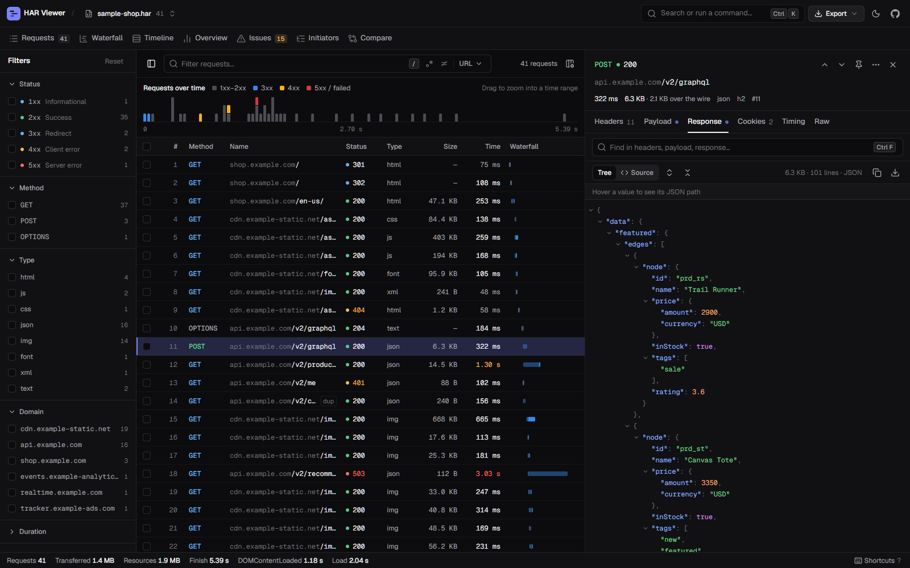

# HAR Viewer · Lumen

A fast, private HAR file viewer for developers who spend too much time staring at network tabs, now with a cinematic 3D landing, a calm pastel interface and new analysis views.

Drop in a `.har` file — even a massive one — and get a searchable, filterable, keyboard-driven view of every request. No uploads, no servers: everything stays in your browser.



## What's new in Lumen

**The film.** The landing page is a scroll-driven three.js story that follows one request through each phase a HAR records:

| Act | Scene | HAR phase |
| --- | --- | --- |
| Intro | ~2,400 light particles gather into the logo, then pour into a glass browser window | — |
| 01 · Request | A 3D cursor presses _Add to cart_; a glowing packet is born with a comet trail | `send` |
| 02 · DNS | The packet hops through a constellation of name servers while a glowing route grows | `dns` |
| 03 · Connect & TLS | SYN / SYN-ACK / ACK pulses, the rings interlock, a padlock springs into place | `connect`, `ssl` |
| 04 · Waiting | A server tower thinks, queries orbit, time slows down and the TTFB ring fills | `wait` |
| 05 · Download | A spiralling river of ~5,000 bytes in phase colours flows home | `receive` |
| 06 · Captured | The sample capture becomes a 3D waterfall; every bar springs into place | — |
| 07 · Your turn | An iridescent portal frames the drop zone | — |

The motion is driven by physics, not linear tweens:

- The camera is a spring rig on keyed Catmull-Rom splines, with inertial scroll and pointer parallax.
- The packet, the waterfall bars and the padlock move on springs.
- Particles fall with real gravity and drag.
- Bloom, AgX/neutral tone mapping and fog are tuned for soft colours.
- A custom spring cursor, magnetic buttons, a 3D tilt drop zone and a chapter rail complete the landing.

The landing loads lazily and falls back to the classic welcome screen when WebGL is unavailable. It also respects `prefers-reduced-motion` and lowers the pixel ratio on slow GPUs.

**New views**

- **Galaxy**: the capture as a 3D solar system. The page is the sun, domains are planets (first-party or third-party) and requests are moons coloured by status. Hover for details, click to inspect, and replay the capture in time order at 1×, 4× or 16×.
- **Endpoints**: API calls grouped by route pattern (`/users/:id`, `:uuid`, `:hash`), with p50, p95 and max latency, error rate and status codes.
- **Security**: an A–F grade from security-header coverage (HSTS, CSP, nosniff, frame protection, Referrer-Policy, Permissions-Policy), cookie flags, secrets in URLs, credentials over plain HTTP, CORS misconfigurations and version disclosure.
- **Overview**: adds a **Health score** (TTFB, reliability, load time, weight, request count, compression and warnings, with tips ordered by impact) and a **first-party vs third-party** breakdown.

**Design.** "Lumen" tokens: warm cream paper, plum ink and sage, lavender, peach, sky, blush and butter accents. Dark mode is a soft twilight dusk, never pure black. The interface adds Fraunces display type, glass surfaces, a sliding tab pill, cursor spotlights on cards, count-up stats, an orbit loader and confetti.

**Easter eggs.** Try ↑↑↓↓←→←→BA on the landing page or in the app, click the landing logo five times, or click anywhere in the 3D scene.

## Why this exists

Browser DevTools are great until you need to share a network capture, dig through hundreds of requests offline, or compare traffic from a device you don't have in front of you. HAR files solve that, but most viewers either choke on large files or give you a wall of JSON. This one doesn't.

## Features

**Explore**

- **Request table** — virtualized, sortable, with columns that adapt to the space available. Pinned requests float to the top; duplicates and notes are flagged inline.
- **Faceted filters** — status class, method, type and domain with live counts and one-click “only”, plus duration and size ranges with quick presets.
- **Search** — URL, headers, bodies or everything; regex and invert modes. Matching rows show where the match was (headers, request/response body, cookies).
- **Time histogram** — requests over time, stacked by status. Drag across it to zoom the table into a time window.
- **Saved views** — name any filter combination and reapply it to any capture. Filters are also encoded in the URL for sharing.

**Inspect**

- **Inspector** — headers, payload (JSON, GraphQL, form, multipart), response, cookies (with URL/base64 decoding), timing and raw JSON, plus WebSocket messages.
- **Response viewer** — collapsible JSON tree with JSONPath breadcrumbs, syntax-highlighted source view for JSON/HTML/XML/CSS/JS, image previews, copy and download.
- **Find in request** — `⌘/Ctrl F` searches across the inspector with match count and next/previous navigation.
- **Timing breakdown** — each phase (queued, DNS, connect, TLS, send, TTFB, download) drawn where it happened.

**Analyze**

- **Waterfall** — every phase for every request, with DOMContentLoaded and Load markers.
- **Timeline** — per-domain lanes that show concurrency.
- **Overview** — totals, status and content-type breakdowns, a group-by pivot table, caching, compression, protocol and average-timing insights, slowest and largest requests.
- **Issues** — automated checks for failed requests, mixed content, slow TTFB, slow requests, redirect chains, oversized images, large responses, missing cache headers, likely render-blocking resources and duplicates. Passed checks are listed too.
- **Initiators** — the “who requested what” tree from `_initiator` data or Referer headers.
- **Compare** — load a second HAR to see what got faster, slower, added or removed.
- **Request diff** — header and body differences between any two requests.

**Act**

- **Copy as** cURL, fetch, axios, Python requests, HTTPie, wget or PowerShell (properly shell-quoted).
- **Export** HAR, sanitized HAR (credentials, cookies, secret-looking payloads and query params redacted), CSV, Postman collection, or cookies (Netscape `cookies.txt` / JSON) — for ticked rows or everything visible.
- **Bulk actions** — tick rows (Shift-click for ranges) for export, diff or delete. Deletes are undoable.
- **Notes & pins**, **replay** (subject to CORS), **merge** several HAR files into one timeline.
- **Command palette** (`⌘/Ctrl K`) for every action, plus full keyboard navigation (`?` lists shortcuts; `1`–`0` switch between the ten views).

**Under the hood**

- Parsing runs in a **Web Worker** with streaming read progress, so huge files never freeze the UI.
- The session (including deletions) is kept in **IndexedDB**; filters, pins, notes and layout persist across reloads.
- Light, dark and system themes; works down to phone widths (sidebar and inspector become sheets).
- Validation flags malformed entries without blocking the load.

## Getting started

```bash
npm install
npm run dev
```

Open the printed URL, then drop a `.har` file on the page — or click **Explore a sample capture**.

## Scripts

| Script            | Purpose                                       |
| ----------------- | --------------------------------------------- |
| `npm run dev`     | Vite dev server                               |
| `npm run build`   | Type-check and build for production (`dist/`) |
| `npm run preview` | Serve the production build                    |
| `npm run check`   | Type-check, lint and unit-test in one go      |
| `npm test`        | Vitest unit tests for the domain layer        |
| `npm run lint`    | ESLint (incl. React Compiler rules)           |
| `npm run format`  | Prettier (with Tailwind class sorting)        |

## How to get a HAR file

- **Chrome / Edge** — DevTools → Network → enable _Preserve log_, reproduce, then _Export HAR_ (or right-click → _Save all as HAR with content_).
- **Firefox** — DevTools → Network → ⚙ → _Save All As HAR_.
- **Safari** — enable developer features, then Web Inspector → Network → _Export_.
- **Proxies** — Charles, Fiddler, Proxyman, HTTP Toolkit and mitmproxy all export HAR.

HAR files can contain cookies and tokens — use **Sanitized HAR** export before sharing one.

## Tech stack

- **three.js** for the landing film and the Galaxy view (lazy-loaded chunk)
- **React 19** with the **React Compiler**, **TypeScript 6** (strict, `noUncheckedIndexedAccess`)
- **Vite 8** (Rolldown) with route-level code splitting and a Web Worker parser
- **Tailwind CSS v4** with a token-based design system (OKLCH, light/dark)
- **Radix UI** primitives, **cmdk** (command palette), **sonner** (toasts), **lucide** icons
- **Zustand 5** (sliced store, memoized derived selectors), **TanStack Virtual**, **react-resizable-panels**
- **idb-keyval** for IndexedDB persistence; self-hosted **Geist** fonts (works offline)
- **Vitest**, **ESLint 10** (typescript-eslint, react-hooks), **Prettier**

## Project structure

```
src/
  app/              App root: session restore, theme, drag & drop, global shortcuts
  har/              Pure domain logic — parsing, filtering, search, metrics, issue checks,
    export/         compare, initiators, and exporters (HAR, CSV, Postman, snippets). Unit-tested.
  store/            Zustand slices (capture, filters, selection, UI) + memoized selectors
  services/         Side effects: worker parsing, IndexedDB session, exports, replay, URL state
  workers/          HAR parser Web Worker
  hooks/            Small reusable hooks (media queries, theme, element size, file drop)
  lib/              Framework-agnostic helpers (formatting, downloads, clipboard, platform)
  components/
    ui/             Design-system primitives (button, menus, dialog, tabs, command, …)
    *.tsx           Shared app components (status/method labels, key-value lists, charts)
  features/         One folder per product area:
    shell/          Header, view tabs, workspace layout, status bar, bulk-action bar
    filters/        Facet sidebar, search field, active-filter chips, saved views
    requests/       Virtualized table, row cells, time histogram, column menu
    inspector/      Request detail panel, tabs and response viewer
    landing/        Cinematic three.js story (scene/), custom cursor, motion hooks, story script (acts.ts)
    galaxy/ endpoints/ security/
    waterfall/ timeline/ overview/ issues/ initiators/ compare/
    command/ dialogs/ shortcuts/ entry-actions/ welcome/
  styles/           Tailwind entry + design tokens
```

### Design system notes

All colors are semantic tokens in `src/styles/globals.css`, defined separately for light and dark. Chart colors (timing phases, status series) were checked for color-vision-deficiency separation and contrast in both modes. Status is never communicated by color alone — codes, labels and icons always accompany it.

## License

MIT
